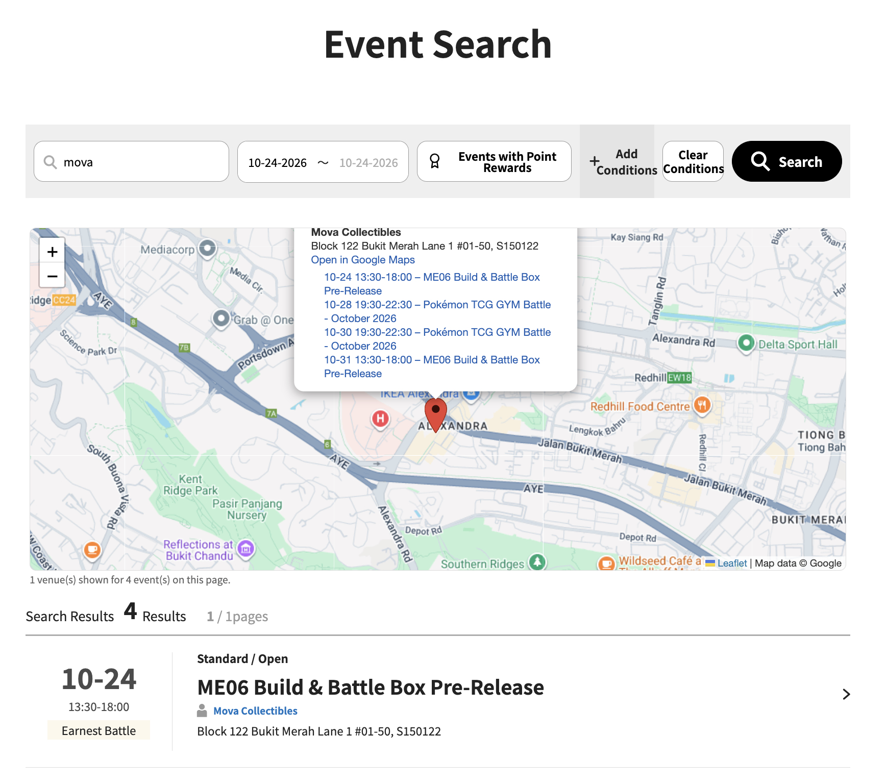

# Pokémon TCG Event Search – Map

A userscript that adds an interactive map right below the search bar on the Pokémon TCG Asia event search page, with a pin for every venue in the search results.

> **Tested only on Pokémon TCG Asia – Singapore** (`https://asia.pokemon-card.com/sg/event-search/search/`). Other regions of the site are not supported: the script only matches the `/sg/` page and its geocoding is tuned for Singapore addresses.

## Features

- Map with Google Maps tiles, inserted between the search form and the results — **no API key required**
- One pin per venue; clicking it shows the organizer, the address, an "Open in Google Maps" link and every event held there, linked to its detail page
- Works with any search filter (keyword, dates, event type…) and shows the results of the current page
- Shows your current location (blue dot) automatically if you've already granted this site location permission, or on demand via the locate button under the zoom controls
- Resolves "Refer to venue address" listings by reading the address from the event detail page
- Caches venue coordinates locally, so repeat visits are near-instant

## Install

Works with [Tampermonkey](https://www.tampermonkey.net/) (desktop browsers) and [Userscripts](https://apps.apple.com/app/userscripts/id1463298887) (Safari on iPhone, iPad and Mac).

### Tampermonkey

1. Install the [Tampermonkey](https://www.tampermonkey.net/) browser extension.
2. Open the [raw script](https://raw.githubusercontent.com/dgallitelli/pokemon-event-map/main/pokemon-event-map.user.js) — Tampermonkey will offer to install it.
3. Go to the [event search page](https://asia.pokemon-card.com/sg/event-search/search/) and search.

Tampermonkey will pick up future versions automatically via `@updateURL`.

### Userscripts (Safari, iOS/macOS)

1. Install [Userscripts](https://apps.apple.com/app/userscripts/id1463298887) from the App Store and enable it in Safari's extension settings, allowing it on `asia.pokemon-card.com`.
2. Open the [raw script](https://raw.githubusercontent.com/dgallitelli/pokemon-event-map/main/pokemon-event-map.user.js) in Safari, tap the Userscripts icon in the address bar, and choose **Install**.
3. Open the [event search page](https://asia.pokemon-card.com/sg/event-search/search/).

## How it works

The site does not expose venue coordinates, only free-text addresses, so the script geocodes them with free, keyless services:

| Step | Service |
|------|---------|
| Address contains a 6-digit postal code | [OneMap](https://www.onemap.gov.sg/) (Singapore Land Authority) |
| Otherwise, or if OneMap fails | [Nominatim](https://nominatim.openstreetmap.org/) (OpenStreetMap), rate-limited to 1 req/s, after stripping unit numbers/floors |

The script only uses the async `GM.*` API, the subset that Tampermonkey and Userscripts both support. The map is rendered with [Leaflet](https://leafletjs.com/) using Google Maps tiles.

## Caveats

- The Google tile endpoint is unofficial and not covered by Google's Maps Platform terms; it may change or stop working at any time.
- OneMap's keyless access currently works but returns a "token missing" notice and throttles bursts; if it starts requiring a token, the script falls back to Nominatim.
- Only the results on the current page (20 per page) are mapped.
- Not affiliated with The Pokémon Company or Nintendo.

## License

[MIT](LICENSE)
